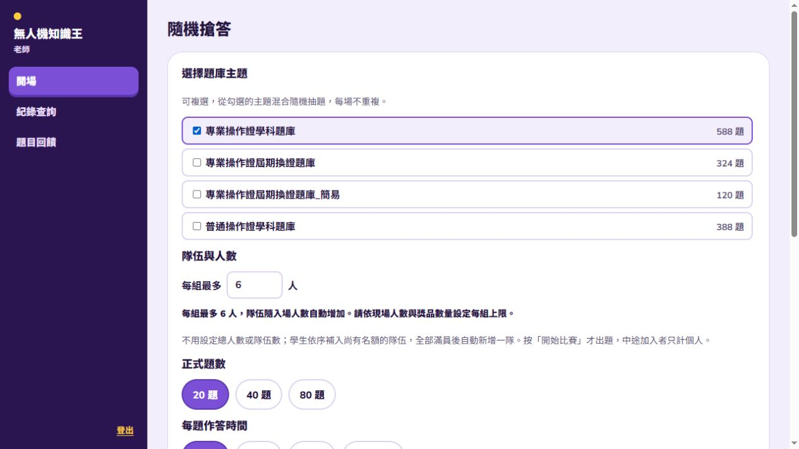
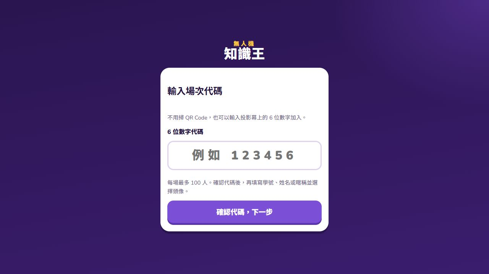
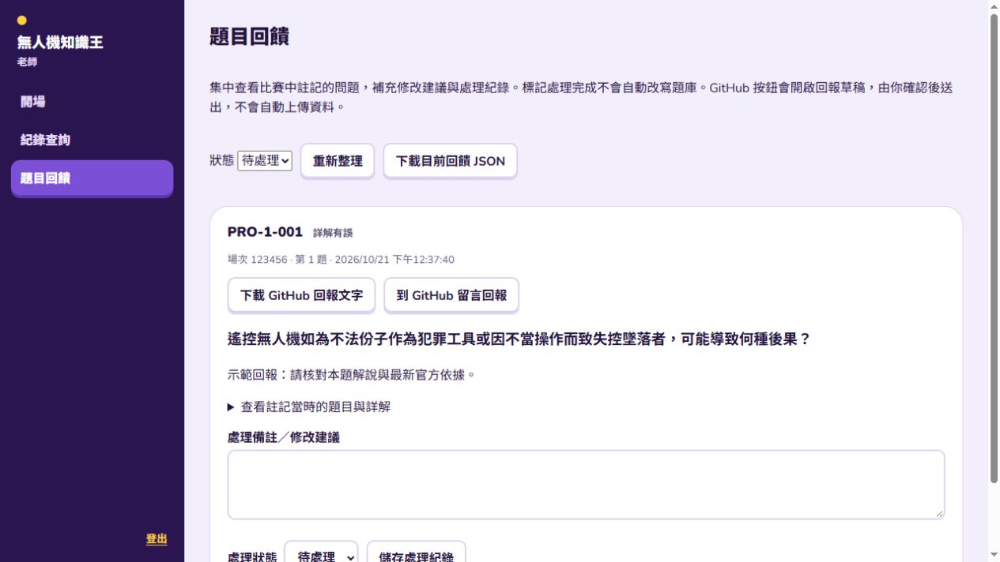
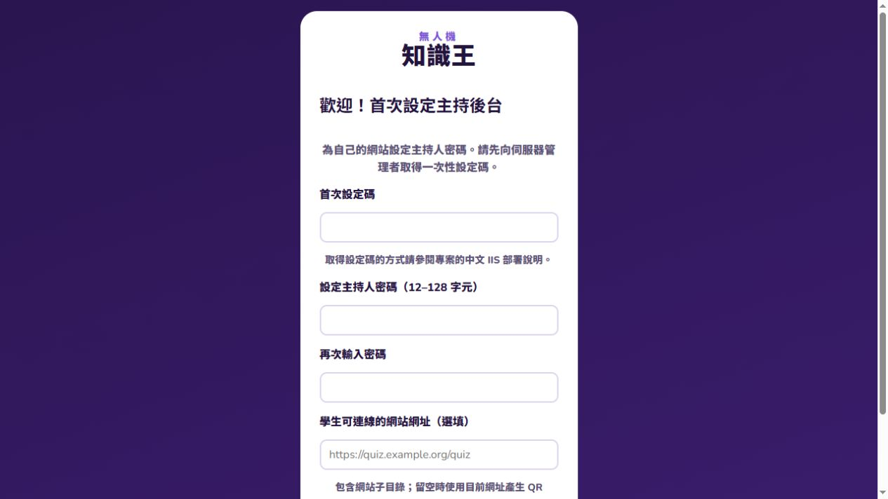

# 無人機知識王｜IIS 自架版

以繁體中文操作的無人機題庫即時競賽系統。**整包下載、部署到自己的 Windows IIS；每個站台自行設定主持人密碼、保存資料及負擔主機流量。** 不需要作者的伺服器、雲端服務或付費 API；GitHub 用於下載程式及回報問題。

## 畫面預覽







## 直接部署，不需要編譯

1. 在 GitHub 點 **Code → Download ZIP**，解壓縮整份專案，或執行 `git clone https://github.com/unron0830/uavquiz.git`。
2. `iis/quiz` 就是已建置好的網站，含完整題庫與圖片。正式主機不用安裝 Node.js、Python、資料庫、URL Rewrite、ARR 或 WebSocket。
3. 依照 [中文 IIS 部署說明](docs/IIS部署.md) 啟用 ASP.NET 4.8、建立網站／應用程式集區、設定資料夾權限，再使用首次設定精靈（或本機設定腳本）。
4. 主持人使用 `https://你的主機/quiz/#/host`；學生使用 `https://你的主機/quiz/#/join`，輸入場次代碼，或掃描投影頁 QR Code。

**第一次進入 `#/host` 會顯示設定精靈**：輸入伺服器上的一次性設定碼、設定密碼、再次確認密碼，以及選填對外網址。沒有共用或預設主持人密碼；完成後才可開場。也可使用部署腳本預先設定。網站放在根目錄時，網址省略 `/quiz`。



## 三種角色

|角色|用途|
|---|---|
|主持後台 `#/host`|設定題庫、題數、作答秒數、講解秒數、每隊人數；開始、揭曉、顯示詳解、手動下一題、頒獎|
|電腦投影|由主持後台「開啟投影頁」取得專屬網址，顯示加入 QR Code、隊員、題目及排名|
|學生 `#/join`|輸入六位場次代碼，以學號／真名／暱稱加入，選擇或上傳頭像並作答|

投影網址包含場次存取憑證，請從後台取得；主持人密碼不要交給學生。

## 題庫與競賽

內附四類題庫，共 1,420 題：專業操作證學科題庫 588 題、專業操作證屆期換證題庫 324 題、專業操作證屆期換證題庫_簡易 120 題、普通操作證學科題庫 388 題。可複選主題，隨機抽 20／40／80 題，另有兩題隨機暖身題。

- 作答時間：15／20／30 秒，或自行輸入 15–120 秒；講解秒數另外選擇。
- 預計比賽時間包含作答、講解與每題換題預估 20 秒；實際換題由主持人操作。
- 每隊最多人數自行設定；入場依序填滿隊伍，開始前顯示隊員，方便坐在一起討論。
- 最多 100 位參賽者；預設允許中途加入，中途加入者只計個人排名。
- 正式題答對 1,000 分，加上最高 500 分速度獎勵；暖身不計分。每題顯示即時及累積排名。
- **團隊排名按答對率：全隊答對次數 ÷（計分隊員數 × 正式計分題數）**，未作答算錯；暖身、作廢題及中途加入者排除。同答對率時，答對題平均耗時較短者優先。
- 詳解顯示解說與圖片，答案關鍵字標紅；部分詳解可能需要校訂，請依最新官方資料確認。

## 錯誤回饋

主持人顯示詳解時，可點「回饋詳解有誤」，勾選解說／圖片／法規問題並填寫建議。回饋保存在**自己的伺服器** `App_Data/feedback/`；後台「題目回饋」可匯出 JSON、下載回報文字，或點 **到 GitHub 留言回報**。

GitHub 按鈕會開啟 [本專案 Issues](https://github.com/unron0830/uavquiz/issues) 的回報草稿，由使用者登入並自行送出。不會自動寄信、上傳學生資料或連線到作者的遊戲伺服器。圖片請自行附上截圖；完整長文可使用「下載 GitHub 回報文字」後貼上。

## 主機容量與資料管理

100 人的隔離後端負載測試曾通過，但不代表所有硬體與網路都保證流暢。Windows 10／11 的用戶端 IIS 有同時請求限制，正式 100 人活動建議使用 Windows Server IIS，並在自己的主機與 Wi-Fi 先做全流程測試。限制是同時處理的請求數，不是可登入人數；參見 [Microsoft 說明](https://learn.microsoft.com/en-us/iis/troubleshoot/request-restrictions)。

資料保存在 `App_Data`，不使用 SQL 資料庫；姓名有格式限制，頁面文字經跳脫，CSV 避免公式注入。對外使用請啟用 HTTPS，限制管理者存取設定檔，並依活動需要定期備份或刪除學生資料。[更多資料與更新說明](docs/IIS部署.md)。

## 修改原始碼

需要 Node.js 22.13 以上與 Python 3（僅重建合併 C# 檔需要 Python）。

```powershell
npm ci
npm run typecheck
npm test
npm run build
npm run package:iis
```

前端在 `apps/web`，ASP.NET C# 原始碼在 `apps/iis/App_Code`，共用型別在 `packages/shared`。建置後 `iis/quiz` 可再次部署；打包腳本保留既有 `App_Data`，不會替你建立密碼。

## 題庫來源

題目來源資訊保留在各題的 `source_name`、`source_url`、`source_version` 與原始題號欄位；相關權利歸原權利人。程式附帶的整理、解說與圖片不代表民航局官方解釋，考試請以主管機關最新公告為準。參見 [題庫來源與使用說明](docs/題庫來源.md)。
